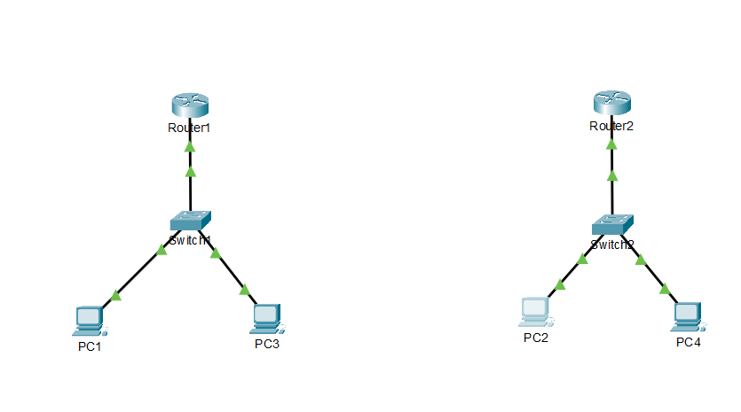
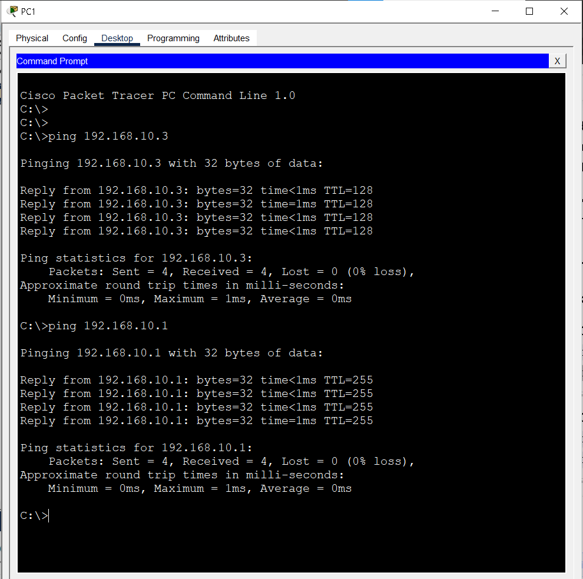
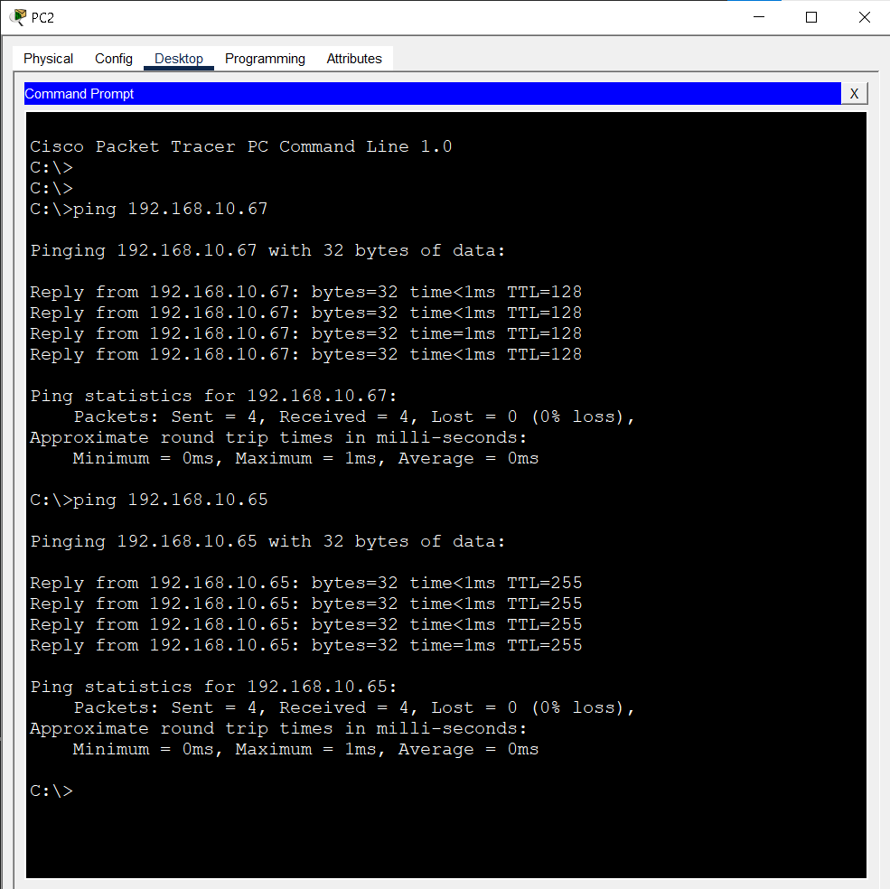

# CCNA Task 2: IPv4 Addressing and Subnetting

## 🎯 Objective
Master binary conversion, understand subnet boundaries, and design a Variable Length Subnet Mask (VLSM) scheme to efficiently allocate IP addresses for a /24 network. The newly designed subnets were then applied to a live Cisco Packet Tracer topology to verify connectivity.

## 🖼️ Topology & VLSM Design
The network was carved into two separate LANs based on the host requirements using VLSM.

### VLSM Subnet Allocation Table
*Base Network: `192.168.10.0/24`*

| Requirement | Subnet ID | Subnet Mask | Usable Host Range | Broadcast Address |
| :--- | :--- | :--- | :--- | :--- |
| **50 Hosts** (LAN 1) | `192.168.10.0` | `/26` (255.255.255.192) | `.1` - `.62` | `.63` |
| **25 Hosts** (LAN 2) | `192.168.10.64` | `/27` (255.255.255.224) | `.65` - `.94` | `.95` |
| **12 Hosts** (Spare) | `192.168.10.96` | `/28` (255.255.255.240) | `.97` - `.110` | `.111` |
| **2 Hosts** (P2P) | `192.168.10.112` | `/30` (255.255.255.252) | `.113` - `.114` | `.115` |
| **2 Hosts** (P2P) | `192.168.10.116` | `/30` (255.255.255.252) | `.117` - `.118` | `.119` |

## 🛠️ Tools Used
*   **Cisco Packet Tracer** (Network Simulation)
*   **Cisco IOS** (Router & Switch Configuration)

## ⚙️ Methodology & Key Actions
1.  **Binary & VLSM Math:** Converted decimal octets to binary by hand to verify subnet calculations. Carved the `192.168.10.0/24` parent network into five subnets, assigning the largest subnets first to prevent overlapping address space.
2.  **Topology Re-addressing:** 
    *   **LAN 1 (Left):** Re-addressed PC1 and PC3 within the `192.168.10.0/26` range. Set Router 1's interface to `192.168.10.1` as the default gateway.
    *   **LAN 2 (Right):** Re-addressed PC2 and PC4 within the `192.168.10.64/27` range. Set Router 2's interface to `192.168.10.65` as the default gateway.
3.  **Verification:** Confirmed local Layer 2/Layer 3 connectivity by pinging the local gateway and neighbor PCs from end-devices.

## ✅ Verification & Proof
**PC1 Connectivity (LAN 1):**
Pinging the local gateway (`192.168.10.1`) returned `TTL=255` (Cisco IOS default). Pinging the neighbor PC (`192.168.10.3`) returned `TTL=128` (Windows default).

**PC2 Connectivity (LAN 2):**
Pinging the local gateway (`192.168.10.65`) and neighbor PC4 (`192.168.10.67`) confirmed the `/27` subnet boundaries are correctly applied.

## 🔍 Critical Analysis & Lessons Learned
*   **Why VLSM Matters:** Allocating a standard `/24` to a point-to-point link wastes 252 IP addresses. Using a `/30` for router-to-router links and `/26` for larger LANs proves an understanding of IP conservation, a vital skill for enterprise networking.
*   **The "Invalid Gateway" Error:** During reconfiguration in Packet Tracer, an "Invalid Gateway" error occurred when applying IPs. This was caused by the simulator applying the new subnet mask before the IP address updated. Refreshing the simulation clock resolved the ARP and subnet mask mismatch.
*   **What I'd Improve:** In a production environment, DHCP would be configured on the routers to automatically assign these VLSM addresses to the end hosts rather than static configuration.

## 📁 Lab Files
*   📄 [**View Full Detailed Lab Report (PDF)**](./CCNA%20Task%202%20-%20IPv4%20Addressing%20and%20Subnetting.pdf)
*   💻 [**Download Packet Tracer Lab File (.pkt)**](./task-two-CCNA.pkt) *(Requires Cisco Packet Tracer)*
