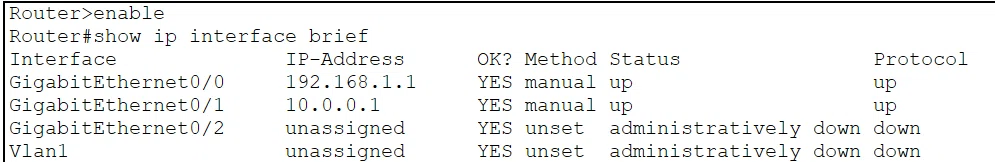
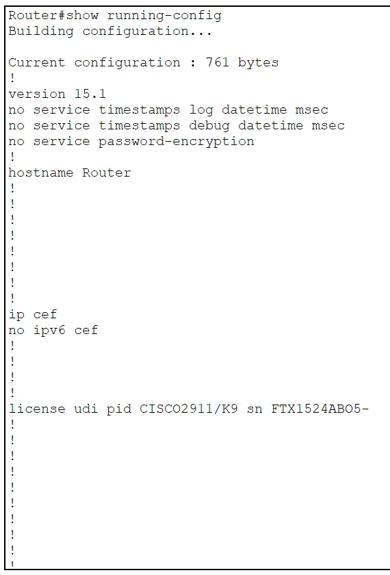
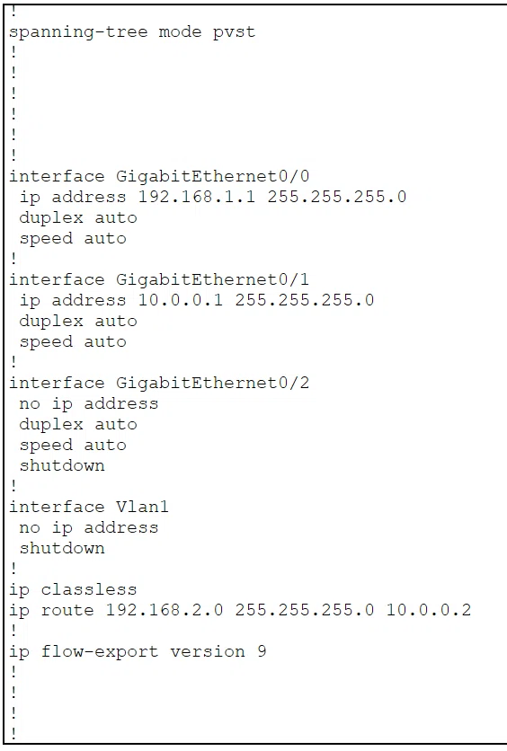

# CCNA Task 3: The IOS Command Line, Interfaces and Recovery

## 🎯 Objective
Navigate the Cisco IOS CLI hierarchy, secure device access, interpret interface and configuration states, and document the emergency password recovery procedure using the configuration register.

## 🛠️ Tools Used
*   **Cisco Packet Tracer** (Network Simulation)
*   **Cisco IOS** (Router Configuration)

## ⚙️ Methodology & Key Actions
1.  **Device Hardening:** Configured the device hostname, enforced an MD5/SHA-hashed `enable secret` password, and secured VTY lines (0-4) with SSH-only transport to prevent plaintext Telnet access.
2.  **Interface Analysis:** Executed `show ip interface brief` to evaluate the Layer 1 (Status) and Layer 2 (Protocol) health of all router interfaces.
3.  **Configuration Audit:** Audited the active `running-config` to verify static routing and interface addressing.
4.  **Persistence:** Executed `copy running-config startup-config` to save the active configuration from RAM to NVRAM, ensuring it survives a reload.
5.  **Recovery Simulation:** Documented the 5-step ROMMON password recovery process using the configuration register.

## 🔍 Critical Analysis & Evidence

### 1. Interface State Analysis (`show ip interface brief`)

**Critical Breakdown:**
*   **`GigabitEthernet0/0` & `GigabitEthernet0/1` (up/up):** The `Status` column confirms Layer 1 (physical cabling/carrier signal) is active. The `Protocol` column confirms Layer 2 (data-link framing) is operational. 
*   **`GigabitEthernet0/2` (administratively down):** This proves the physical port is healthy, but an administrator intentionally disabled it using the `shutdown` command. This is a critical security best practice to prevent unauthorized physical access to unused switchports.

### 2. Active Configuration Audit (`show running-config`)

**Critical Breakdown:**
*   **`ip route 192.168.2.0 255.255.255.0 10.0.0.2`:** This static route is the most vital line in the config. It instructs the router to forward any traffic destined for the remote `192.168.2.0/24` subnet to the next-hop IP `10.0.0.2`.
*   **`ip classless`:** Enabled by default in modern IOS, this allows the router to use a default route (`0.0.0.0/0`) if a specific subnet match is not found in the routing table.

## 🔐 Password Recovery Procedure
If locked out, the router can be recovered via the Configuration Register (`0x2142`):
1.  **Interrupt Boot:** Power-cycle the router and send a Break sequence (Ctrl+Break) via console to enter ROMMON.
2.  **Bypass Startup:** In ROMMON, set `confreg 0x2142` and reload. The router boots with a blank config, ignoring the saved passwords.
3.  **Merge Config:** Enter Privileged EXEC (`enable`), then run `copy startup-config running-config` to load all previous settings back into RAM.
4.  **Reset Password:** Enter Global Config, set a new `enable secret`, and issue `no shutdown` on all interfaces (they default to down when config is bypassed).
5.  **Restore Boot:** Change the register back to `0x2102` (`config-register 0x2102`) and save (`copy run start`).

## 📁 Lab Files
*   📄 [**View Full Detailed Lab Report (PDF)**](./CCNA%20Task%203%20-%20The%20IOS%20Command%20Line,%20Interfaces%20and%20Recovery.pdf)
