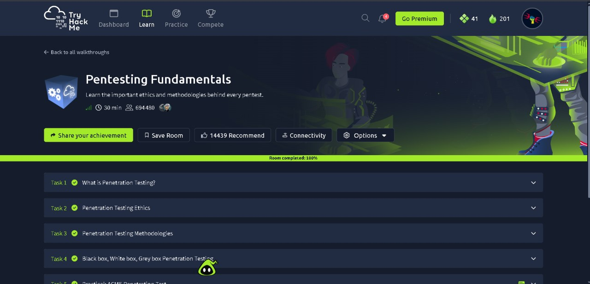
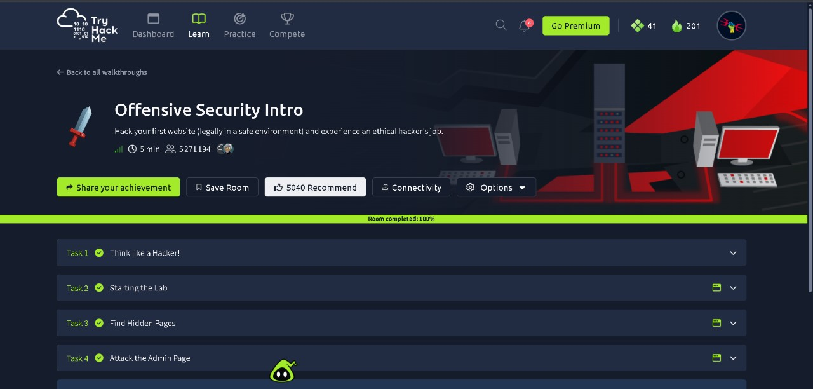

# Ethical Hacking Task 1: Cyber Security & Ethical Hacking Intro

## 🎯 Objective
Establish the core foundations of offensive security and ethical hacking. This task focuses on understanding the CIA Triad, categorizing different types of hackers, defining the 5 phases of an attack lifecycle, and distinguishing between a penetration test and a vulnerability assessment.

## 🛠️ Resources Used
*   **TryHackMe** (Pentesting Fundamentals & Offensive Security Intro)
*   **Technical Report Writing**

## ⚙️ Key Concepts Mastered
1.  **The CIA Triad:** 
    *   *Confidentiality:* Encrypting databases to prevent unauthorized reading.
    *   *Integrity:* Using SHA-256 hashes to verify a file hasn't been altered.
    *   *Availability:* Defending against DDoS attacks to keep services online.
2.  **Hacker Types:**
    *   *White Hat:* Ethical hackers testing with explicit permission.
    *   *Black Hat:* Malicious actors exploiting systems for personal gain.
    *   *Grey Hat:* Hackers who find flaws without permission but lack malicious intent.
3.  **The 5 Phases of Ethical Hacking:** Reconnaissance -> Scanning -> Gaining Access -> Maintaining Access -> Covering Tracks.
4.  **PenTest vs. Vulnerability Assessment:** A vulnerability assessment is an automated scan listing potential flaws. A penetration test is a manual, simulated attack that actively exploits them to determine the depth of the compromise.

## 🔍 Evidence & Practical Work
The following TryHackMe rooms were completed to reinforce the methodology and ethics behind ethical hacking.

## 📁 Lab Files
*   📄 [**View Full Detailed Lab Report (PDF)**](./Ethical%20Hacking%20Internship%20-%20Task%201%20Report.pdf)
