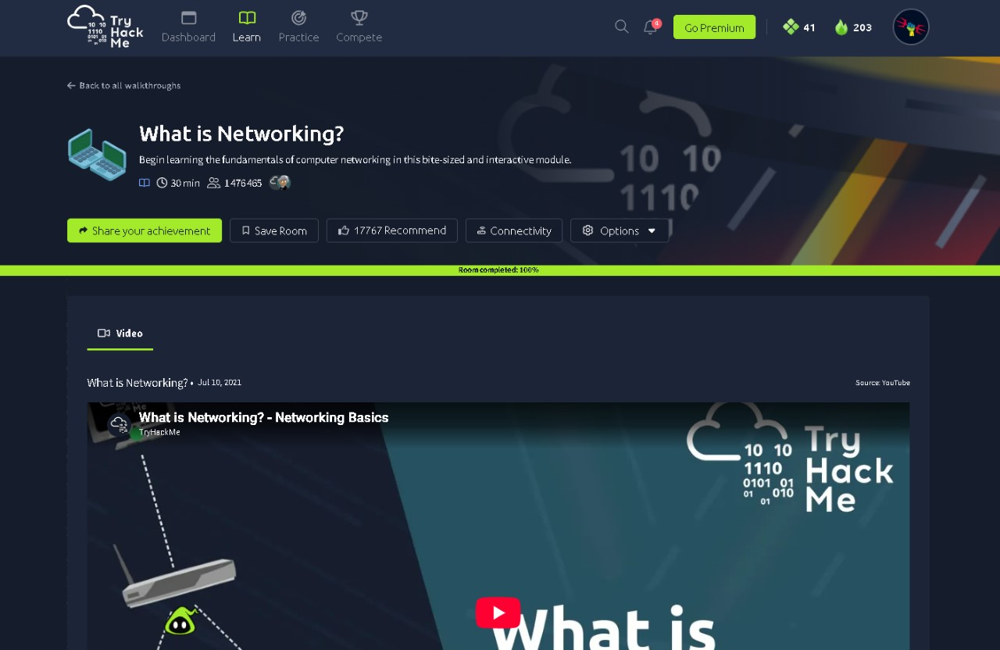
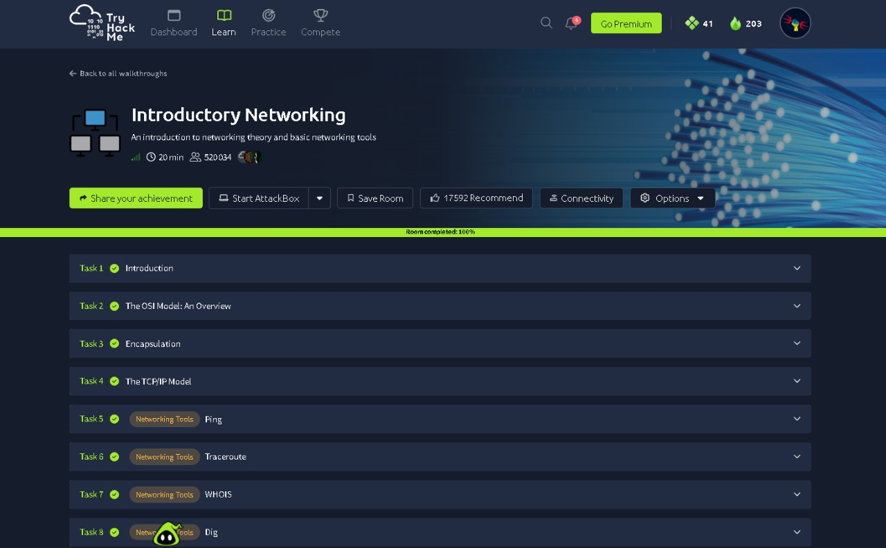
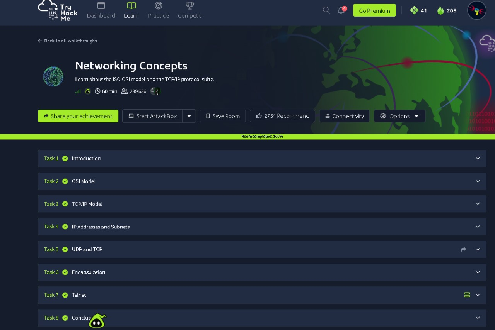

# Ethical Hacking Task 2: Networking Basics for Offensive Security

## 🎯 Objective
Understand the foundational network protocols and OSI model from an attacker's perspective. The focus of this lab is on IP addressing, port enumeration, and transport layer protocols (TCP/UDP), which are critical for mapping an attack surface during a penetration test.

## 🛠️ Resources Used
*   **TryHackMe** (What is Networking?, Introductory Networking, Networking Concepts)
*   **Local Terminal** (Windows `ipconfig` / Linux `ip a`)

## ⚙️ Key Concepts Mastered & Critical Analysis

### 1. Private IP Address Discovery
Before initiating an attack, a penetration tester must understand their local network context. I used terminal commands to identify my machine's RFC 1918 private IP address. Private IPs (e.g., `192.168.x.x`, `10.x.x.x`) are non-routable on the public internet, which is crucial to know when attempting to pivot through internal network segments.

### 2. The OSI Model (7 Layers)
Understanding the OSI model is the difference between a script kiddie and a penetration tester. It tells you exactly where a vulnerability lives and which layer an exploit will target.
*   **Layer 7 (Application):** HTTP, DNS. *Attack vector:* SQL Injection, XSS.
*   **Layer 6 (Presentation):** SSL/TLS. *Attack vector:* Weak cipher downgrades.
*   **Layer 5 (Session):** RPC. *Attack vector:* Session hijacking.
*   **Layer 4 (Transport):** TCP/UDP. *Attack vector:* SYN flooding, port scanning.
*   **Layer 3 (Network):** IP. *Attack vector:* IP spoofing, ICMP tunneling.
*   **Layer 2 (Data Link):** MAC, ARP. *Attack vector:* ARP spoofing, MAC flooding.
*   **Layer 1 (Physical):** Cables, Wi-Fi. *Attack vector:* Wiretapping, physical destruction.

### 3. Common Ports & Attack Surface Mapping
Port enumeration is a foundational phase of reconnaissance. By identifying active services, an attacker can map the attack surface and target vulnerable daemon versions.
*   **Port 21 (FTP):** Plaintext file transfer. Highly vulnerable to credential sniffing and anonymous login abuse.
*   **Port 22 (SSH):** Secure remote shell. Heavily targeted via brute-force and credential stuffing.
*   **Port 23 (Telnet):** Completely plaintext. Instant credential interception if open.
*   **Port 53 (DNS):** Frequently leveraged for DNS zone transfers, tunneling, and Command & Control (C2) traffic.
*   **Port 80/443 (HTTP/HTTPS):** Susceptible to web app attacks (SQLi, XSS) and plaintext manipulation on port 80.
*   **Port 445 (SMB):** Windows file sharing. Notoriously targeted for Remote Code Execution (e.g., EternalBlue) and lateral movement.
*   **Port 3389 (RDP):** Graphical Windows management. Heavily targeted by brute-force attacks.

### 4. TCP vs. UDP (3 Differences)
*   **Connection:** TCP is connection-oriented (requires a 3-way handshake: SYN, SYN-ACK, ACK). UDP is connectionless (fires packets without establishing a prior session).
*   **Reliability:** TCP guarantees packet delivery and automatically retransmits lost packets. UDP does not guarantee delivery and is susceptible to packet loss.
*   **Speed/Overhead:** TCP is slower due to error checking and acknowledgments. UDP is much faster and has lower overhead, making it ideal for streaming, gaming, or DNS queries.

## 🔍 Evidence & Practical Work
The following TryHackMe rooms were completed to reinforce the fundamentals of IP addressing, the OSI model, and transport protocols.

## 📁 Lab Files
*   📄 [**View Full Detailed Lab Report (PDF)**](./Ethical%20Hacking%20Task%202%20-%20Networking%20Basics.pdf)
