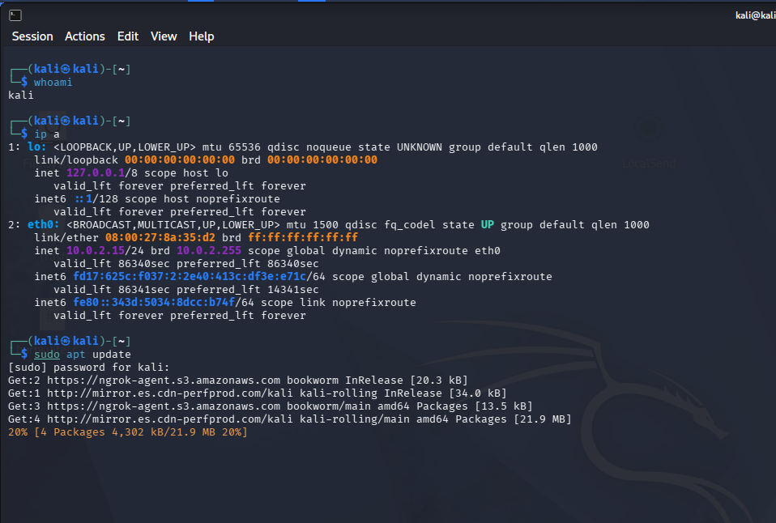
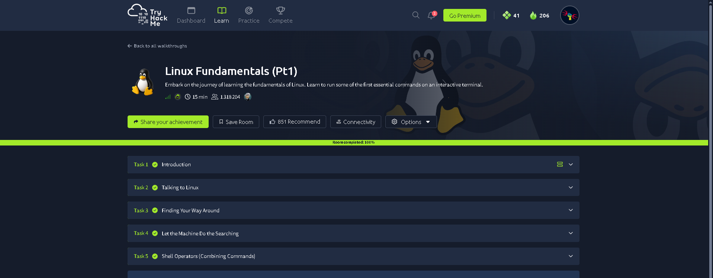

# Ethical Hacking Task 3: Kali Linux Installation & Lab Setup

## 🎯 Objective
Build a dedicated, isolated attack platform using Oracle VirtualBox and Kali Linux. This environment serves as the foundation for all offensive security operations, ensuring that exploitation, payload delivery, and malware analysis can be performed safely without compromising the host machine or local network.

## 🛠️ Tools & Technologies
*   **Oracle VirtualBox** (Hypervisor / Sandbox Environment)
*   **Kali Linux** (Industry-standard penetration testing distribution)
*   **Linux CLI** (Command Line Interface)

## ⚙️ Methodology & Key Actions

### 1. Virtual Environment Configuration
Installed VirtualBox and imported the pre-built Kali Linux VM image. Configured the virtual network adapter to an **Internal Network**. This is a critical defensive measure: it ensures that if I detonate malware or launch reverse shells during a penetration test, the traffic is contained within the virtual sandbox and cannot leak to my physical router or ISP.

### 2. System Verification & Command Analysis
Upon booting into the Kali desktop environment, I opened a terminal to verify system privileges, network configuration, and package management. 

*   **`whoami`**: Verified the current user context (`kali`). In real-world engagements, establishing privilege level is the first step before attempting local enumeration.
*   **`ip a`**: Inspected the network interfaces. Confirmed `eth0` is up and assigned an IPv4 address, verifying the VM is communicating correctly on the virtual switch.
*   **`sudo apt update`**: Synchronized the package repository lists. A penetration tester must ensure all exploitation tools (Metasploit, Nmap, Burp Suite) are up-to-date to the latest stable versions before an assessment.

## 🔍 Evidence & Lab Proof

### Kali Linux Desktop Environment

### Terminal Verification (`whoami`, `ip a`, `apt update`)

### Proof of Practical Work (TryHackMe)
Completed the foundational Linux CLI training to ensure efficient navigation and scripting capabilities within the Kali environment.

## 🔍 Critical Analysis & Lessons Learned
*   **The Importance of Snapshots:** Before installing new tools or running potentially unstable exploits, taking a VirtualBox Snapshot is essential. If the VM crashes or gets corrupted by a payload, I can instantly revert to a clean, working state.
*   **CLI Proficiency:** In offensive security, relying on GUI tools is inefficient. Mastering commands like `ip a` for networking and `apt` for package management is mandatory for speed and remote SSH administration.

## 📁 Lab Files
*   📄 [**View Full Detailed Lab Report (PDF)**](./Ethical%20Hacking%20Task%203%20-%20Kali%20Linux%20Installation%20and%20Lab%20Setup.pdf)
