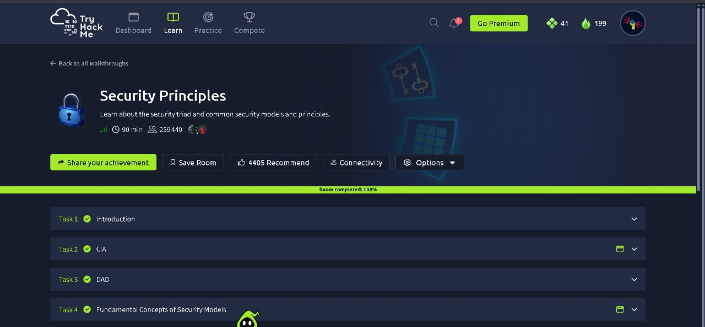
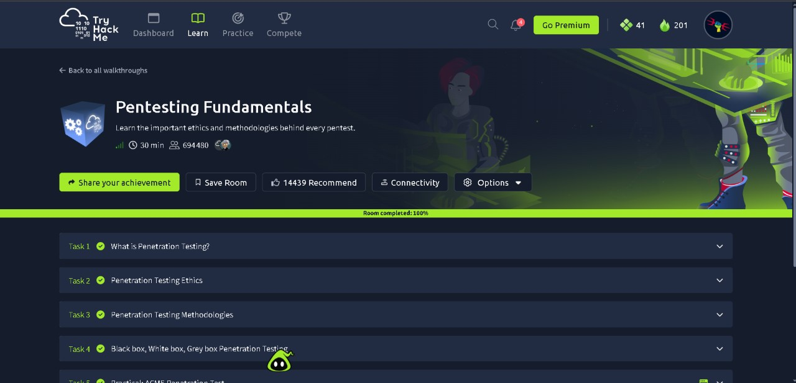

# SOC Task 1: Cyber Security Intro & What is a SOC?

## 🎯 Objective
Establish the foundational concepts of cybersecurity from a defender's perspective. This includes understanding the CIA Triad, differentiating between threats, vulnerabilities, and risks, and mapping out the hierarchical roles within a Security Operations Center (SOC).

## 🛠️ Resources Used
*   **TryHackMe** (Security Principles & Pentesting Fundamentals)
*   **Technical Report Writing**

## ⚙️ Key Concepts Mastered
1.  **The CIA Triad:** Confidentiality (privacy of data), Integrity (accuracy of data), and Availability (accessibility for authorized users).
2.  **Threat vs. Vulnerability vs. Risk:** A threat is a danger (hacker), a vulnerability is a flaw (unpatched software), and risk is the intersection where a threat exploits a vulnerability.
3.  **SOC Analyst Tiers:**
    *   **L1 (Triage):** Monitors alerts, filters false positives, handles ticketing.
    *   **L2 (Incident Response):** Deep-dives into escalated alerts, investigates attacks, isolates machines.
    *   **L3 (Threat Hunting):** Proactive hunting, deep forensics, reverse engineering malware.
4.  **Blue Team vs. Red Team:** Blue Team builds defenses and monitors; Red Team simulates attacks to test Blue Team readiness.

## 🔍 Critical Analysis & Evidence
A SOC acts as the "guards of the border" for an organization, utilizing SIEM tools to monitor 24/7. Understanding the L1/L2/L3 structure is critical for knowing when to escalate an incident versus when to handle it autonomously. 

### Proof of Practical Work (TryHackMe)

## 📁 Lab Files
*   📄 [**View Full Detailed Lab Report (PDF)**](./SOC%20Analyst%20Internship%20-%20Task%201%20Report.pdf)
