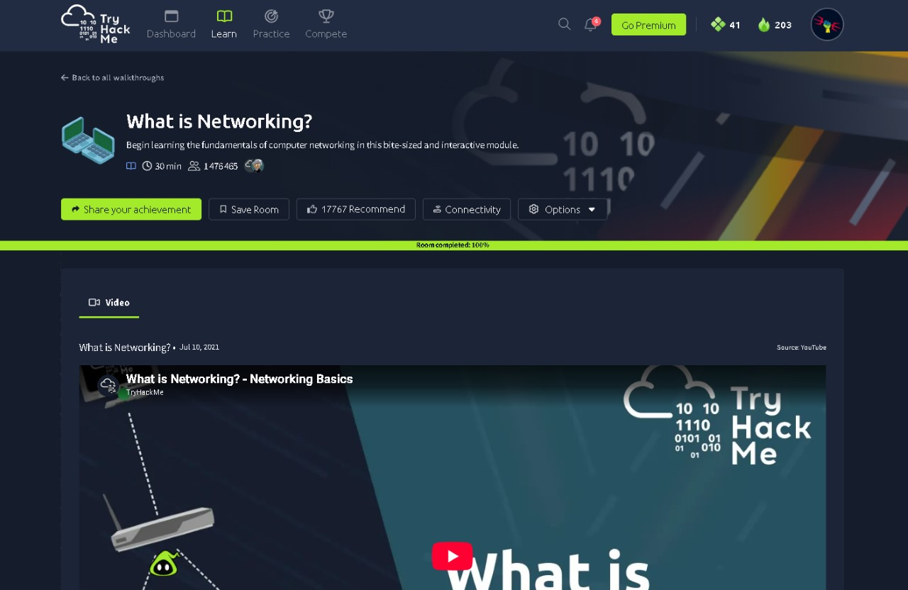
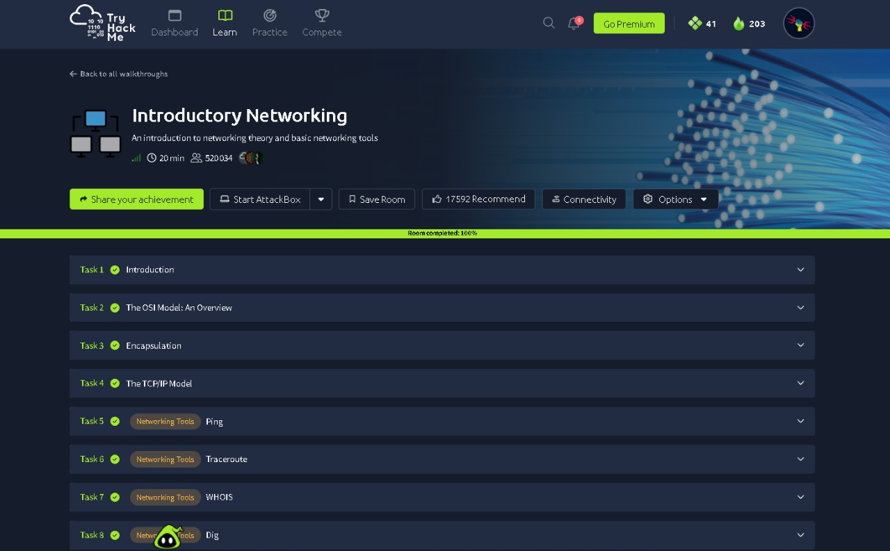
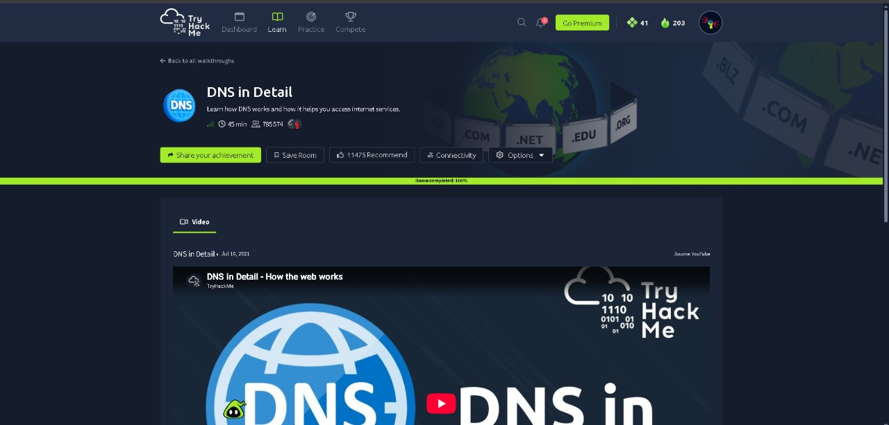

# SOC Task 2: Networking Basics for Defenders

## 🎯 Objective
Analyze networking fundamentals from a Security Operations Center (SOC) perspective. This lab focuses on the OSI model, common port protocols, the DNS resolution lifecycle, and the critical ability to distinguish between normal baseline traffic and suspicious adversary traffic.

## 🛠️ Tools & Resources Used
*   **TryHackMe** (What is Networking?, Introductory Networking, DNS in Detail)
*   **Technical Analysis & Documentation**

## ⚙️ Key Concepts Mastered
1.  **The OSI Model:** Mapped the 7 layers (Application to Physical) to understand where specific attacks (e.g., Layer 7 SQLi vs. Layer 3 IP spoofing) occur and where logs are generated.
2.  **Common Ports:** Documented key ports (22 SSH, 80 HTTP, 443 HTTPS, 53 DNS, 445 SMB, 3389 RDP) and their associated threat vectors.
3.  **DNS Resolution Flow:** Traced the process from local cache to Recursive Resolver, Root Servers, TLD Servers, and finally the Authoritative Name Server.
4.  **Traffic Analysis:** Established the difference between normal traffic (HTTPS during business hours) and suspicious traffic (outbound SMB on port 445 at 3 AM, indicating ransomware or exfiltration).

## 🔍 Critical Analysis & Evidence

### 1. The Defender's View: Normal vs. Suspicious Traffic
*   **Normal:** An employee accessing HTTPS (Port 443) during business hours with predictable TLS handshakes.
*   **Suspicious:** A massive spike in outbound SMB (Port 445) traffic to an unknown external IP at 3:00 AM. SMB is an internal file-sharing protocol and should never traverse the perimeter firewall to the public internet. This indicates lateral movement or data staging for exfiltration.

### 2. Proof of Practical Work (TryHackMe)
The following rooms were completed to reinforce the OSI model, IP addressing, and DNS resolution logic required for SOC Tier 1 triage.

## 📁 Lab Files
*   📄 [**View Full Detailed Lab Report (PDF)**](./SOC%20Task%202%20-%20Networking%20Basics%20for%20Defenders.pdf)
