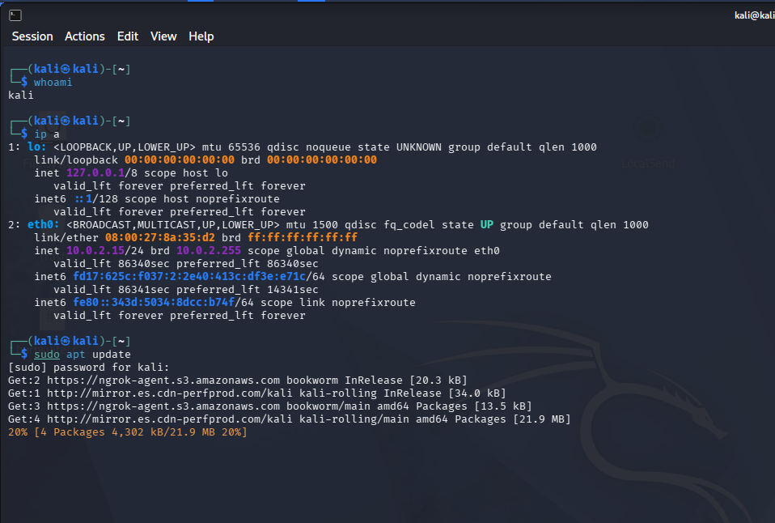

# SOC Task 3: VirtualBox Lab Setup

## 🎯 Objective
Build an isolated, virtualized lab environment for safe security analysis. The objective was to install VirtualBox, set up a Kali Linux Virtual Machine, and configure an internal network to ensure malware analysis and log investigations do not infect the host machine.

## 🛠️ Tools Used
*   **Oracle VirtualBox** (Hypervisor)
*   **Kali Linux** (Offensive/Analysis VM)

## ⚙️ Methodology & Key Actions
1.  **Hypervisor Installation:** Installed VirtualBox on the host machine.
2.  **VM Import:** Imported the pre-built Kali Linux VirtualBox image to save installation time and ensure all security tools were pre-configured.
3.  **Network Isolation:** Configured the VM to use an "Internal Network" adapter. This prevents the VM from bridging to the physical network or the internet, providing a safe "sandbox" for analyzing malicious payloads.
4.  **Verification:** Booted into the Kali desktop, opened a terminal, and executed `ip a` to verify the network interface (`eth0`) was up and assigned an IP address within the isolated subnet.

## 🔍 Evidence & Lab Proof

### 1. Kali Linux Desktop Environment

### 2. Network Verification (`ip a`)

## 🔍 Critical Analysis & Lessons Learned
*   **Why Isolation Matters:** In a SOC environment, analyzing live malware requires a network that cannot reach the corporate LAN or the public internet. VirtualBox's "Internal Network" feature ensures that even if ransomware detonates in the VM, it has no physical path to infect the host.
*   **Troubleshooting:** During the initial setup, the Kali desktop environment had display issues. This required verifying the VM resource allocation (RAM/CPU) and ensuring VirtualBox Guest Additions were properly configured.

## 📁 Lab Files
*   📄 [**View Full Detailed Lab Report (PDF)**](./SOC%20Task%203%20-%20VirtualBox%20Lab.pdf)
