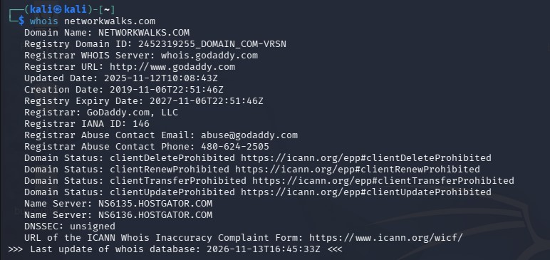
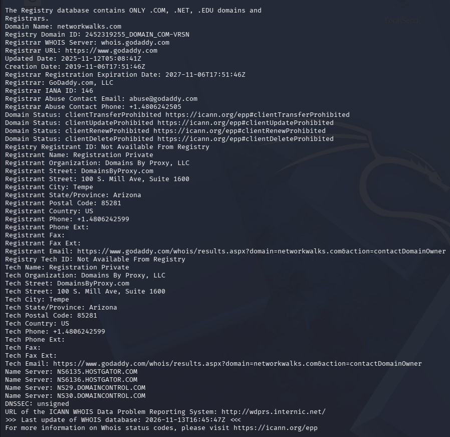
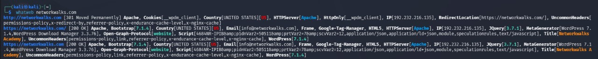
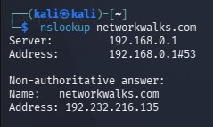
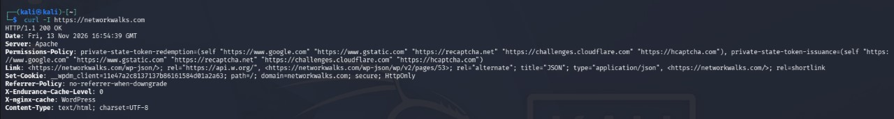
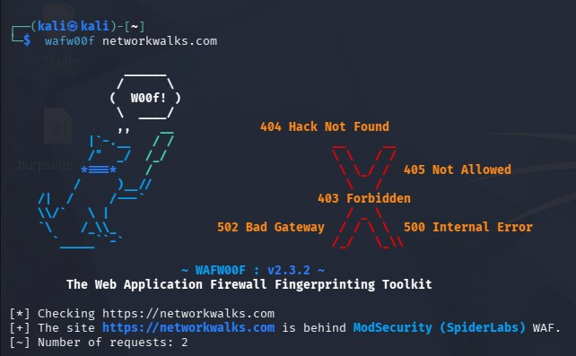
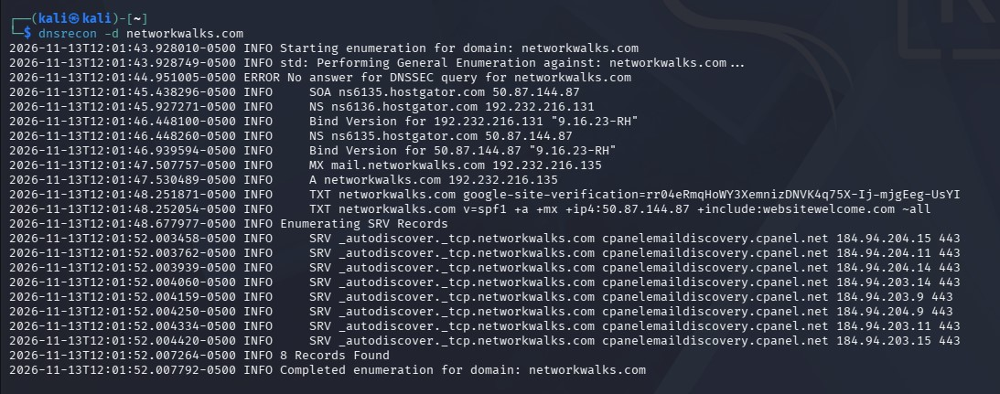
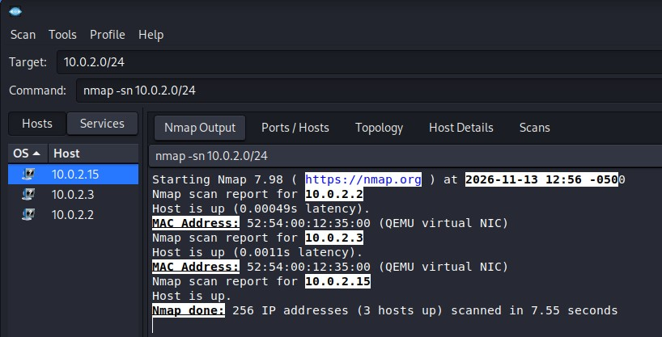

# Networkwalks Cybersecurity Internship — Week 2

## Project Scope
Footprinting, Reconnaissance, and Network Scanning.

## Modules Completed
- **Elective:** W2-PM1 (Multiple Kali Tools)
- **Essential:** W2-PM5 (Zenmap Network Scanning)
- **Essential:** W2-PM-FINAL (Penetration Testing Report)

## Target Infrastructure
- **External Target:** `networkwalks.com` (Authorized for passive reconnaissance)
- **Internal Target:** Local VirtualBox NAT Network (`10.0.2.0/24`)

## Technical Summary

### 1. Footprinting (W2-PM1)
Used six Kali Linux tools to map the external attack surface of `networkwalks.com`.
- **WHOIS:** Identified GoDaddy as the registrar and HostGator name servers.
- **WhatWeb:** Fingerprinted WordPress 7.1.4 and Bootstrap 7.1.4.
- **Nslookup:** Resolved the domain to `192.232.216.135`.
- **Curl -I:** Captured HTTP headers, revealing the `/wp-json/` REST API endpoint.
- **Wafw00f:** Detected a ModSecurity (SpiderLabs) Web Application Firewall.
- **DNSRecon:** Enumerated SOA, NS, MX, A, TXT, and SRV records.

### 2. Network Scanning (W2-PM5)
Used Zenmap to perform a Ping Scan (`nmap -sn`) on the local VirtualBox NAT subnet.
- **Live Hosts Discovered:** 3
- **IP Addresses:** `10.0.2.15` (Kali VM), `10.0.2.2` (Gateway), `10.0.2.3` (DNS).
- **MAC Addresses:** `52:54:00:12:35:00` (QEMU virtual NIC).
- **Topology:** The network topology was saved as a PDF.

## Evidence & Artifacts

📄 **[Click here to view the full Penetration Testing Report (PDF)](Penetration%20Testing%20Report%20-%20Footprinting%20%26%20Network%20Scanning%20Phases.pdf)**

### Screenshot Evidence

| Tool | Screenshot |
| :--- | :--- |
| **1. WHOIS Lookup** |     |
| **2. WhatWeb Fingerprinting** |  |
| **3. Nslookup DNS Resolution** |  |
| **4. Curl HTTP Headers** |  |
| **5. Wafw00f WAF Detection** |  |
| **6. DNSRecon Enumeration** |  |
| **7. Zenmap Ping Scan** |  |

## Disclaimer
All activities were performed against `networkwalks.com` and my own local VirtualBox network, strictly within the authorized scope of the Networkwalks Internship. No exploitation or destructive actions were taken.
