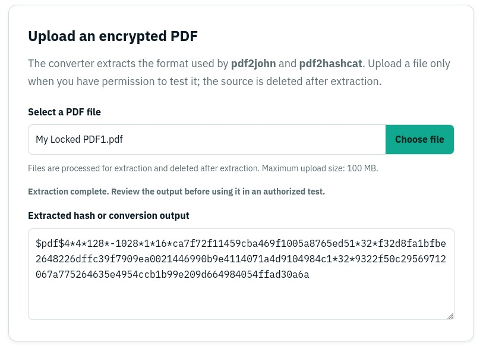
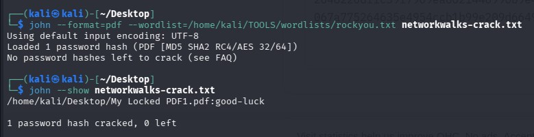
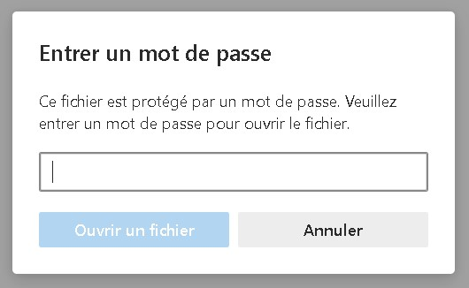
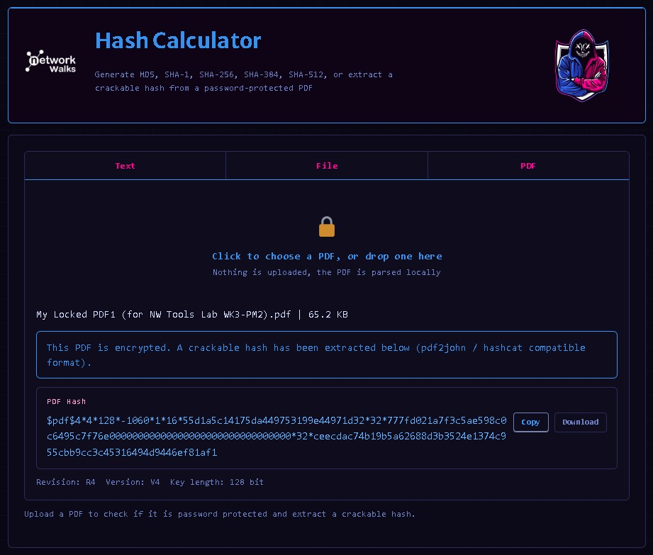
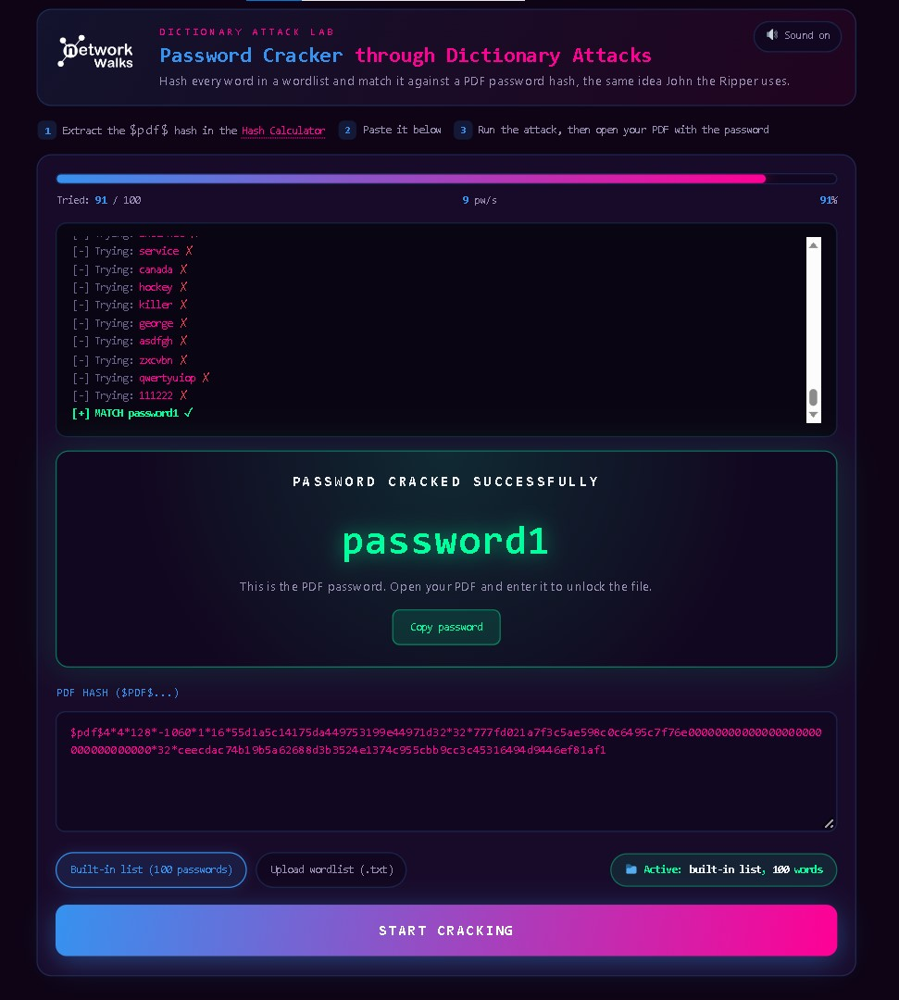
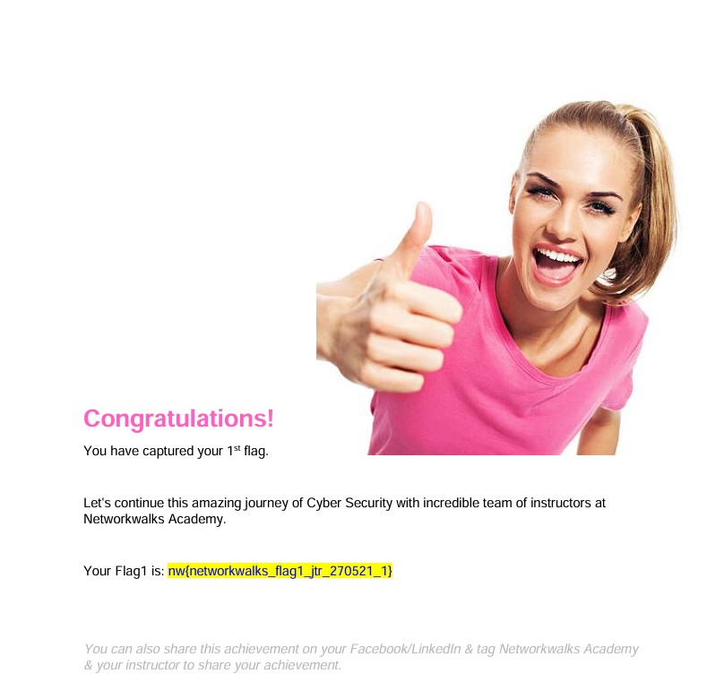

# Networkwalks Cybersecurity Internship — Week 3

## Project Scope
Password Cracking with John the Ripper and Networkwalks Tools.

## Modules Completed
- **Elective:** W3-PM1 (Password Cracking with JTR)
- **Elective:** W3-PM2 (Password Cracking with Networkwalks Tools)

## Executive Summary
The objective of this lab was to recover the passwords of encrypted PDF files. Two methods were used: the command-line tool John the Ripper inside Kali Linux, and the web-based Networkwalks Hash Calculator and Password Cracker. Both successfully recovered the passwords and unlocked the PDFs, revealing the flags.

## Methodology

### 1. W3-PM1: John the Ripper (JTR)
1. **Hash Extraction:** Used the `pdf2john` utility in Kali Linux to extract the password hash from the locked PDF. The output was saved to `networkwalks-crack.txt`.
2. **Cracking:** Used John the Ripper with the `rockyou.txt` wordlist to crack the hash.
   Command used: `john --format=pdf --wordlist=/home/kali/TOOLS/wordlists/rockyou.txt networkwalks-crack.txt`
3. **Result:** John successfully cracked the hash. The recovered password was: `good-luck`.
4. **Flag:** Upon opening the PDF with the recovered password, the flag `nw{cybersecurity_flag_captured_2608}` was revealed.

### 2. W3-PM2: Networkwalks Web Tools
1. Uploaded the locked PDF to the Networkwalks Hash Calculator to extract the hash.
2. Pasted the extracted hash into the Networkwalks Password Cracker.
3. **Result:** The web tool successfully recovered the password: `password1`.
4. **Flag:** Upon opening the PDF with the recovered password, the flag `nw{networkwalks_flag1_jr_270521_1}` was revealed.

## Evidence & Artifacts
All screenshots and the extracted hash file are stored in the repository.

| Evidence | Description |
| :--- | :--- |
|  | Extracting the hash from the locked PDF using pdf2john. |
|  | Terminal output showing John the Ripper successfully cracking the hash. |
|  | The password prompt for the locked PDF. |
|  | The first flag captured using John the Ripper. |
|  | Uploading the PDF to the Networkwalks Hash Calculator. |
|  | The Networkwalks Password Cracker revealing `password1`. |
|  | The second flag captured using the web tool. |

## Conclusion
This lab demonstrated the mechanics of password cracking. It highlighted the importance of using strong, complex passwords for file encryption, as simple dictionary words are cracked in seconds by automated tools. All activities were performed within the authorized lab environment provided by Networkwalks.
